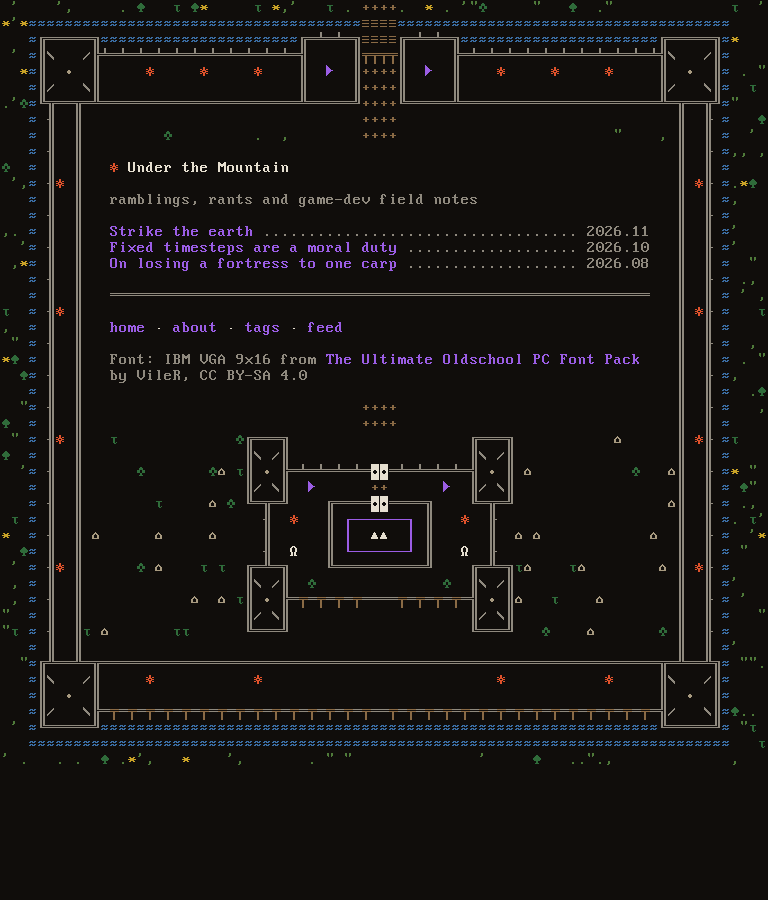

+++
title = "Kitchen sink"
draft = true
date = 2026-11-04
updated = 2026-11-20
[taxonomies]
tags = ["meta", "tooling"]
+++

Test fixture, never published. Every Markdown element in one place so the grid can be eyeballed and checked. Lorem ipsum dolor sit amet, consectetur adipiscing elit, with **strong words**, *emphasis*, `inline code` and [a link to nowhere](#).

Duis aute irure dolor in reprehenderit in voluptate velit esse cillum dolore eu fugiat nulla pariatur. Excepteur sint occaecat cupidatat non proident, sunt in culpa qui officia deserunt mollit anim id est laborum.

## Digging deeper

Curabitur pretium tincidunt lacus. Nulla gravida orci a odio. Nullam varius, turpis et commodo pharetra, est eros bibendum elit, nec luctus magna felis sollicitudin mauris.

> Hacking without art is just cybersecurity.
> Blogging without walls is a text file.

### Lists

- Mine the rock
- Smooth the walls
  - Engrave them too[^carp]
    - With pictures of carp
- Forget about the carp

1. Strike the earth
2. Hit water
   1. Notice the water
   2. Regret
3. Panic

## Code

```rust
fn strike_the_earth(dwarf: &mut Dwarf) {
    // dig responsibly
    dwarf.dig(Direction::Down);
    if dwarf.found(Material::Adamantine) {
        return Err("you know what happens next");
    }
}
```

```sh
zola serve --port 1111
```

## A table

| Dwarf     | Job        | Mood     |
|-----------|------------|----------|
| Urist     | Miner      | Ecstatic |
| Bomrek    | Mason      | Fine     |
| Kadol     | Fisherdorf | Doomed   |

## Images

A plain image, snapped to the grid with padding:



And a before/after slider, a third-party embed snapped to the grid as one block. Drag it:

{{ <compare before="lava.png" after="meadow.png" before_label="lava" after_label="meadow" /> }}

---

### A small heading

Just here so the tiny one below has a parent.

#### A tiny heading

Quotes "like these", an ellipsis... and a dash - typed on a keyboard, as nature intended. Unicode “fancy quotes” and — dashes — still render, because the font has them.

[^carp]: Footnotes need a spot on the grid too.
